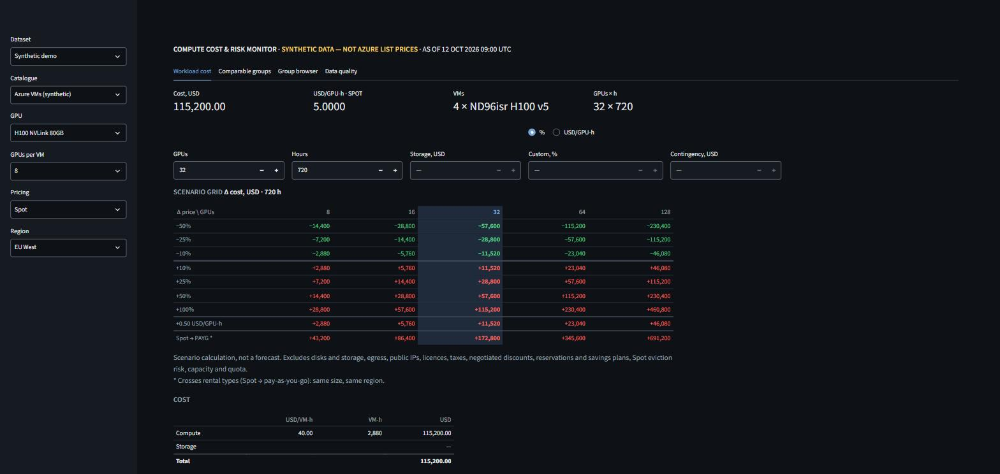

# Compute Cost & Risk Monitor

[](https://github.com/prentopoulos/compute-cost-risk-monitor/actions/workflows/ci.yml)


**What would this GPU workload cost at Azure list prices, and how exposed is the budget if those prices move?**

Compute Cost & Risk Monitor reads Microsoft Azure's published retail list prices for GPU virtual
machines. It sorts them into comparable groups, converts them to USD per GPU-hour, and prices a
workload under labelled scenarios. Every figure traces back to the stored price record it came
from, and deterministic code computes every number.

**In active development.** The dashboard, workload calculator, scenario grid and data-quality
checks run today. The final phase adds a market brief, a methodology document and a short
walkthrough.

**Start here:** [the six-slide deck](docs/compute-cost-risk-monitor-deck.pdf) explains what the
project is, why it matters and how it works, using invented prices.

**Watch:** [the walkthrough video](docs/compute-cost-risk-monitor-walkthrough.mp4) (1:58, with
captions, on invented prices).

## What you get

- A local dashboard over **published Azure list prices for GPU VMs**, or over a labelled
  **synthetic demo** that runs offline.
- **Workload cost:** GPUs × hours × USD/GPU-hour, plus storage only when you enter it, with every
  exclusion stated.
- A **scenario grid:** the change in cost for list-price moves from −50% to +100% (and
  +0.50 USD/GPU-h), for 8 to 128 GPUs. A scenario calculation, not a forecast.
- **Comparable groups** across regions, with thin samples flagged, and a **data-quality panel**
  for missing, duplicate, stale and unmapped rows.
- A **collector** for Microsoft's public Retail Prices API that paces itself to one request per
  second and keeps every original response.

It is **not** a marketplace, a price index or benchmark, executed trades, what customers actually
pay, or a price forecast. It covers one provider, Azure, and list prices only.

| Term | Plain meaning |
| --- | --- |
| List price | Azure's published hourly price for a VM size in a region. Not what a customer with negotiated discounts pays. |
| USD/GPU-h | The VM's hourly list price divided by the GPUs in that VM. |
| Comparable group | Same GPU model and variant, GPUs per VM, region and rental type. Prices are compared only within a group, or the comparison says it crosses groups. |
| Pay-as-you-go / Spot | Azure's standard price / its lower price for capacity Azure can reclaim. Eviction risk is not priced. |
| Single list price | A group with one listed price, so there is nothing to compare inside it. |
| Thin | A cross-region figure from fewer than 5 regions. |
| Stale | The latest snapshot is more than 7 days old. |
| Absent once / not listed | Missing from one snapshot (unconfirmed) / missing from two in a row. |
| Synthetic | Invented prices for demonstration, labelled on every screen. |



*Workload cost on the synthetic demo: 32 H100 GPUs (4 × ND96isr H100 v5) on Spot in EU West for
720 hours, at 5.0000 USD/GPU-h. Invented prices, dated 12 October 2026 (UTC).*

Public screenshots always use the synthetic demo. Collected Azure list prices stay on the machine
that collected them.

## Try it first — no account or key needed

You need **Git** and **[uv](https://docs.astral.sh/uv/getting-started/installation/) 0.13 or
newer**. uv installs Python 3.13 and the locked packages on first use, so the first run needs
internet access. The demo then runs offline. On Windows, clone into a short folder path such as
`C:\src`, or run `git config --global core.longpaths true` first: a few file paths are long.

```bash
git clone https://github.com/prentopoulos/compute-cost-risk-monitor.git
cd compute-cost-risk-monitor
uv run --locked python -m compute_cost_risk_monitor.synthetic tests/fixtures/synthetic/azure_demo.json tests/fixtures/synthetic/marketplace/snapshot-1.json tests/fixtures/synthetic/marketplace/snapshot-2.json tests/fixtures/synthetic/marketplace/snapshot-3.json
uv run --locked python -m compute_cost_risk_monitor.normalize --db data/synthetic.duckdb
uv run --locked streamlit run src/compute_cost_risk_monitor/app.py
```

The same commands work in Windows PowerShell and on macOS or Linux. Open
**http://127.0.0.1:8501** and stop with Ctrl+C. The first command stores the synthetic snapshots
in `data/synthetic.duckdb`; it never writes to the database of collected prices. To rebuild the
demo, delete that file first.

The demo data is dated 12 October 2026 09:00 UTC, so after the same time on 19 October the
dashboard marks it STALE. That is the 7-day rule working.

## Choose how to run it

Run these from the repository folder.

| Mode | Command | Requires |
| --- | --- | --- |
| Synthetic demo | The commands above | Nothing beyond the first install |
| Collect Azure list prices | `uv run --locked python -m compute_cost_risk_monitor.collect`, then `uv run --locked python -m compute_cost_risk_monitor.normalize` | Internet. Reads Microsoft's public, unauthenticated Retail Prices API; refuses a second fetch within 24 hours |
| Data-quality report | `uv run --locked python -m compute_cost_risk_monitor.quality [--db FILE]` | A collected or synthetic database |
| Dashboard | `uv run --locked streamlit run src/compute_cost_risk_monitor/app.py` | Offers whichever databases exist, collected prices first |

The collector only reads published prices: it never calls anything that creates or changes cloud
resources. Microsoft's API page invites tools "for internal analysis and price comparison across
SKUs and regions"; check that your use fits its terms. Collected prices and the original responses
stay in `data/`, which Git ignores. The dashboard listens on 127.0.0.1 only and sends no usage
statistics.

## How comparisons work

```text
USD/GPU-hour     = Azure retail price (USD per VM-hour) ÷ GPUs per VM
workload cost    = GPUs × hours × USD/GPU-hour   (+ storage, only when entered)
budget exposure  = GPUs × hours × scenario price change
```

For example, 32 GPUs for 720 hours with a 0.50 USD/GPU-hour rise in list price is 11,520 USD of
additional cost. On the synthetic demo's US East H100 pay-as-you-go price of 12.0000 USD/GPU-h,
the same workload costs 276,480.00 USD at list price.

- **What is compared:** Linux VMs, pay-as-you-go and Spot, in commercial regions, for sizes
  Microsoft has not retired. GPU counts and models come from a map built only from Microsoft
  Learn's VM size pages. Sizes it does not name exactly stay unmapped and are counted, never
  guessed.
- **What is excluded from every figure:** disks and storage, egress, public IPs, licences, taxes,
  negotiated discounts, reservations and savings plans, Spot eviction risk, capacity and quota.
- **Fixed rules:** the thresholds were set before looking at results. A snapshot is stale after
  7 days, a cross-region figure is thin below 5 regions, and a listing counts as "not listed" only
  after two snapshots in a row without it.
- **Traceability:** every price keeps its source item ID, retrieval time (UTC), original response,
  currency, unit and rental type. Every collection run is labelled `synthetic`, `recorded` or
  `live` by how its bytes were obtained.
- **Independent checks:** separate code recomputes the normalized prices and every workload and
  scenario figure before the dashboard shows them. A figure that fails its check is withheld.

## Project layout

```text
src/compute_cost_risk_monitor/   Collector, normalization, groups, history, calculator, scenarios, checks, dashboard
tests/                           Unit, end-to-end and property tests on synthetic fixtures; no network
openspec/                        Current requirements, and each phase's proposal, design decisions and tasks
docs/                            Architecture diagrams and review records
scripts/                         The quality gate
```

Collected prices live in `data/monitor.duckdb`, original responses in `data/raw/`, and the demo
in `data/synthetic.duckdb`. All three are local working files and excluded from Git.

## Development

```bash
uv sync --locked
npm ci --ignore-scripts
uv run --frozen python scripts/gate.py
```

The gate checks the lockfile, runs Ruff format and lint and strict mypy, and runs pytest with
branch coverage (at least 99% overall and 100% for the calculation and data modules). It also
validates the OpenSpec specs and the commit messages; npm installs only the pinned OpenSpec CLI.
Tests use synthetic fixtures and block the network, so they need no account, key or live data.
CI runs the same gate on every pull request.

The project was built phase by phase with [OpenSpec](https://github.com/Fission-AI/OpenSpec):
each phase's decisions, with who made them, are in `openspec/changes/archive/`.

## Licence and credits

This project's code and documentation are released under the [MIT License](LICENSE).
Third-party material keeps its own licence:
- The GPU map contains material from Microsoft Learn, © Microsoft, licensed under
  [CC BY 4.0](https://creativecommons.org/licenses/by/4.0/). See
  [its attribution](src/compute_cost_risk_monitor/reference/README.md).
- The vendored grilling skill is MIT-licensed by its author. See
  [its licence](.agents/skills/grilling/LICENSE).

Azure is a trademark of Microsoft. This project is not affiliated with or endorsed by Microsoft.
